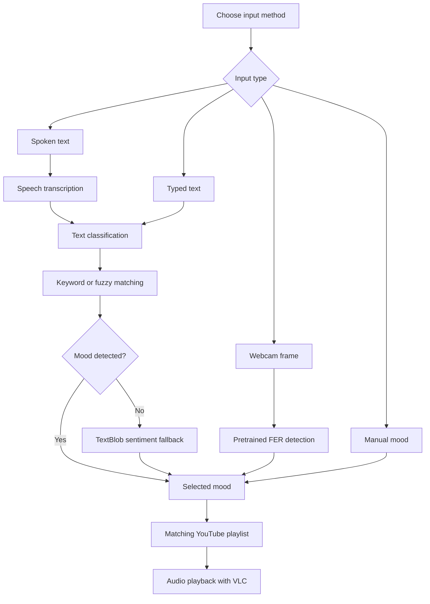

# Smart Mood-Responsive Music Generator

**Python · Natural Language Processing · Computer Vision · Multimodal Interaction · Desktop GUI**

A Python desktop application that selects music playlists based on mood information provided through **text, speech, facial expressions, or manual selection**. The application combines rule-based text classification, sentiment analysis, a pretrained facial-expression recognition library, speech transcription, and an interactive music player.

## Project Overview

Music preferences can vary with a listener's current mood. This project explores a multimodal human–computer interaction workflow in which different input methods lead to a common set of mood categories and corresponding YouTube playlists.

The application, presented in the interface as **MoodyTunes**, supports seven playlist categories: **happy, sad, angry, calm, anxious, tired, and neutral**. Playlist selection is rule-based; the application does **not** train a custom machine-learning model or generate new music.

## Core Features

| Component | Implementation |
| --- | --- |
| **Text mood classification** | Corrects text with TextBlob, checks mood keywords and approximate matches using `difflib`, then falls back to sentiment polarity when needed. |
| **Speech-based mood input** | Captures microphone audio with SpeechRecognition, requests transcription via Google's speech recognition service, and applies the text classifier. |
| **Facial-expression input** | Reads webcam frames with OpenCV and uses the pretrained FER detector (`mtcnn=True`) to map a detected expression to a supported playlist category. |
| **Manual mood selection** | Provides a dropdown for direct selection of any of the seven available moods. |
| **Music playback** | Retrieves tracks from predefined YouTube playlists with `yt-dlp` and plays audio through VLC bindings. |
| **Desktop interface** | Uses CustomTkinter for mood input, a scrollable song list, playback controls, and a progress slider. |
| **Background processing** | Uses Python threads for tasks such as mood detection, transcription, and playback progress updates. |

## Mood-Selection Logic



For text and transcribed speech, recognized mood keywords take priority. If no close keyword match is found, sentiment polarity classifies the input as **happy, sad, or neutral**. Facial-expression predictions are mapped to the application's available moods; they are not independent measurements of a person's internal emotional state.

## Engineering Skills Demonstrated

- **Python application development:** object-oriented programming, callbacks, and modular functions.
- **Natural language processing:** spelling correction, keyword-based classification, fuzzy matching, and sentiment analysis.
- **Computer vision integration:** webcam capture and inference with a pretrained facial-expression recognition package.
- **Speech processing:** microphone input, speech-to-text integration, and reuse of the text-classification pipeline.
- **GUI development:** interactive CustomTkinter components, dynamic labels, and audio playback controls.
- **Third-party integration:** YouTube metadata extraction with `yt-dlp` and audio playback with VLC.
- **Concurrent programming:** background worker threads for blocking operations.

## Technology Stack

| Area | Technology |
| --- | --- |
| Programming language | Python 3.10 (original project recommendation) |
| Desktop interface | CustomTkinter |
| Text analysis | TextBlob, `difflib` |
| Webcam and facial expressions | OpenCV, FER (pretrained detector) |
| Speech-to-text | SpeechRecognition, PyAudio, Google's recognition service |
| Media integration | `yt-dlp`, python-vlc, VLC Media Player |
| Concurrency | `threading` |

## Running the Application

The project was documented for **Python 3.10.11**. A compatible VLC Media Player installation and an internet connection are required for music playback. Webcam and microphone access are necessary only for their respective input modes.

Install the Python dependencies:

```bash
python -m pip install -r requirements.txt
```

Start the desktop application:

```bash
python SMRG_Music.py
```

VLC must be installed and accessible to the Python bindings. The speech feature relies on access to Google's external transcription service; YouTube playlist retrieval and playback depend on third-party availability. Package versions in `requirements.txt` reflect the original project's documented environment and have not been validated against every current operating system.

## Scope and Limitations

This is a **desktop software prototype**, not an emotion-diagnosis or therapeutic system.

- Mood classification uses predefined categories, heuristics, and a pretrained facial-expression detector; it has **not** been validated as a reliable measure of a user's emotional state.
- Facial detection selects a mood when a recognized expression is encountered; it is **not** a continuous, validated emotion-tracking system.
- Music playback depends on external YouTube playlist URLs, the availability of stream formats, and the installed VLC environment.
- Speech transcription is performed through an external service, and microphone/webcam permissions are required for those modes.
- Background threads interact with GUI controls; additional thread-safe event handling and failure reporting would be needed for production use.
- No accuracy, performance, or user-study metrics are claimed.

**Project type:** Python desktop application / multimodal interaction prototype.
